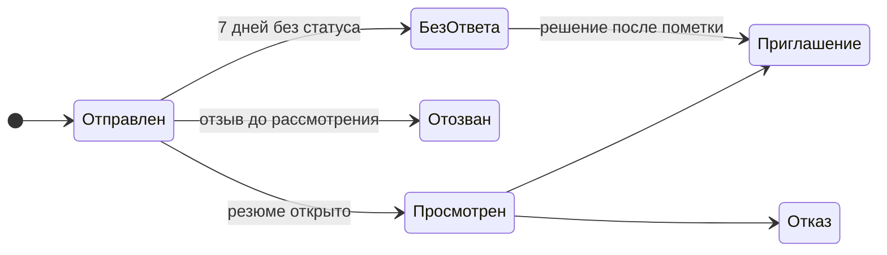

# Влад: бизнес-аналитика, продукт, процессы

**Считаю на данных, описываю процессы и формулирую требования, чтобы продуктовые решения принимались на фактах, а не на ощущениях.**


*Макет главной страницы WorkWave, платформы поиска удалённой работы, которой я руководил как CEO.*

## Проблема и решение

| Проблема | Как решаю | Где видно |
|---|---|---|
| Решения о закупках принимаются по марже в рублях, без учёта срока оборота и концентрации продаж | SQL-анализ, ABC-анализ, доходность на вложенный рубль в день оборота | [Аналитика перепродажи](https://github.com/<логин>/<репозиторий-1>) |
| Идея платформы не превращается в проверяемые требования, документы противоречат друг другу | Истории, требования, сценарии, BPMN и модель данных со сквозной трассировкой и списком открытых вопросов | [WorkWave](https://github.com/<логин>/<репозиторий-2>) |
| Заявка на грант без обоснования рынка, конкурентов и экономики не проходит | Стандартный пакет: интервью, TAM/SAM/SOM, конкуренты, бизнес-модель, план MVP | [Стартап-проекты](https://github.com/<логин>/<репозиторий-3>) |

## Ключевые результаты

- Подготовлено **21 заявка** на грант Фонда содействия инновациям («Студенческий стартап», 2024 — 2025).
- Для одной платформы описано **68 пользовательских историй, 89 функциональных и 21 нефункциональное требование, 8 сценариев** использования, процесс BPMN и схема БД.
- В данных кейса по мотивам собственного бизнеса найден главный риск: **одна позиция даёт 55% продаж и около 41% маржи**, а **12 из 48 товаров формируют 80% маржи**.

## Проекты

### Аналитика перепродажи техники на маркетплейсах
Кейс по мотивам собственного проекта: закупка на Wildberries, Ozon и Яндекс Маркете, продажа частным клиентам и магазинам.
- **Решение:** база из пяти таблиц, 656 продаж, шесть аналитических вопросов на SQL, дашборд, процесс закупки AS-IS и TO-BE, требования к боту подбора товаров.
- **Вывод:** максимальная маржа в рублях не равна максимальной эффективности капитала. Результаты по малым выборкам (наушники, колонки, возвраты) помечены как гипотезы.

### WorkWave: платформа поиска удалённой работы
Соискатель находит вакансию и откликается за несколько шагов, работодатель публикует вакансии и обрабатывает отклики. Моя роль: CEO, полное руководство проектом и все решения. Проект выполнен при поддержке Фонда содействия инновациям.
- **Решение:** полный пакет аналитики, матрица трассировки, диаграммы состояний, матрица ролей и прав, макеты.
- **Контроль качества:** расхождения между документами, макетами и схемой БД выявлены и записаны как открытые вопросы.

### Студенческие стартап-проекты
Шесть проектов в разных нишах: BeautyAdmin, CodeCoach, EcoTrade, SweetMarket, WorkWave, «Будущая свадьба». Роль: аналитик и product manager, март 2024 — август 2025.
- **Решение:** на каждый проект 20–30 проблемных интервью, расчёт PAM/TAM/SAM/SOM, матрица 4–6 конкурентов, юнит-экономика, план MVP на 12 месяцев с бюджетом, презентация на 10–14 слайдов.

## Как посмотреть работы

```bash
git clone https://github.com/<логин>/<репозиторий-1>.git   # перепродажа техники
git clone https://github.com/<логин>/<репозиторий-2>.git   # WorkWave
git clone https://github.com/<логин>/<репозиторий-3>.git   # стартап-проекты
```

- **Аналитика перепродажи:** SQL-скрипты выполняются в PostgreSQL (удобно в DBeaver); дашборд и схема БД лежат в `images/`.
- **WorkWave:** документы читаются прямо на GitHub; исходник процесса `diagrams/workwave-bpmn.bpmn` открывается в [bpmn.io](https://demo.bpmn.io); диаграммы состояний отображаются автоматически.
- **Стартап-проекты:** каждый проект описан в `projects/`, методика оценки рынка в `methodology/`.

## Примеры работ

**SQL: ABC-анализ товаров по марже** (из репозитория про перепродажу)

```sql
WITH product_margin AS (
    SELECT p.product_id, p.product_name, COUNT(*) AS sales_count,
           SUM(s.sale_price - s.purchase_price) AS margin_rub
    FROM sales s
    JOIN products p ON p.product_id = s.product_id
    GROUP BY p.product_id, p.product_name)
SELECT product_id, product_name, sales_count, margin_rub,
       ROUND(margin_rub::numeric / NULLIF(SUM(margin_rub) OVER (), 0) * 100, 2) AS margin_pct,
       ROUND(SUM(margin_rub) OVER (ORDER BY margin_rub DESC, product_name
             ROWS BETWEEN UNBOUNDED PRECEDING AND CURRENT ROW)::numeric
             / NULLIF(SUM(margin_rub) OVER (), 0) * 100, 2) AS cumulative_pct
FROM product_margin
ORDER BY margin_rub DESC, product_name
```

**Требования: от истории до функционального требования** (из WorkWave)

| Артефакт | Содержание |
|---|---|
| История AUTH-5 | Как пользователь, я хочу восстановить пароль, чтобы вернуть доступ. Критерий: ссылка в письме действует 60 минут, после смены пароля старые сессии завершаются |
| ФТ-1.9 | Система должна позволять восстановить пароль: отправить на почту одноразовую ссылку сброса с ограниченным сроком действия и задать новый пароль |
| Сценарий UC-02 | Вход в систему, расширение: актор забыл пароль |
| BPMN | Подпроцесс «Восстановление пароля» после события «Забыли пароль?» |

**Жизненный цикл отклика** (из WorkWave, диаграмма Mermaid)



## Технологии и навыки

| Направление | Инструменты и методы |
|---|---|
| Данные | PostgreSQL (JOIN, CTE, оконные функции), DBeaver, Excel, Power BI |
| Процессы | BPMN 2.0, AS-IS и TO-BE, bpmn.io |
| Требования | Пользовательские истории, функциональные и нефункциональные требования, MoSCoW, сценарии использования, критерии приёмки, матрица трассировки |
| Моделирование | ER-диаграммы, диаграммы состояний (Mermaid), диаграммы вариантов использования |
| Продукт и рынок | TAM/SAM/SOM, проблемные интервью, анализ конкурентов, бизнес-модели, план MVP и бюджет |
| Прототипирование | Figma |

## Контакты

<почта> · <Telegram>
