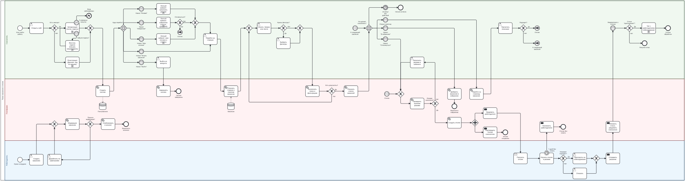

# WorkWave: платформа поиска работы

Аналитическая документация веб-платформы поиска работы: соискатели ведут резюме и откликаются на вакансии, работодатели публикуют вакансии и обрабатывают отклики, администратор модерирует публикации.

Репозиторий содержит артефакты бизнес-анализа: от пользовательских историй до требований, сценариев, BPMN-процесса и схемы данных.

## Роли

| Роль | Задачи |
|---|---|
| Соискатель | Регистрация, резюме, поиск и фильтры, избранное, отклики, личный кабинет |
| Работодатель | Профиль компании, публикация вакансий, обработка откликов, чат с кандидатом |
| Администратор | Модерация вакансий, жалобы, блокировки, справочники |
| Система | Проверки, уведомления, статусы, таймеры |

## Состав документации

| Артефакт | Что внутри | Файл |
|---|---|---|
| Пользовательские истории | 68 историй в 9 эпиках с критериями приёмки и приоритетами MoSCoW | [docs/user-stories.md](docs/user-stories.md) |
| Требования | 9 групп функциональных требований (ФТ) и 21 нефункциональное (НФТ), с трассировкой на истории | [docs/requirements.md](docs/requirements.md) |
| Сценарии использования | 8 use case с диаграммой, предусловиями, основным и альтернативными потоками | [docs/use-cases.md](docs/use-cases.md) |
| Процесс BPMN | Процесс «Поиск вакансии и отклик» с дорожками: соискатель, платформа, работодатель | [diagrams/workwave-bpmn.svg](diagrams/workwave-bpmn.svg), [исходник .bpmn](diagrams/workwave-bpmn.bpmn) |
| Схема БД | ER-диаграмма и описание предметных таблиц | [docs/database.md](docs/database.md) |
| Прототип | Макеты интерфейса в Figma | [Figma](https://www.figma.com/design/IdnyTGSgoSKX4rHOgvB7s2/Untitled?node-id=0-1&t=0pEziW4ID0ZqOWna-1) |

Исходные документы Word лежат в [docs/source](docs/source).

## Диаграммы

### Процесс BPMN



### Диаграмма вариантов использования


### Схема базы данных


## Как связаны артефакты

Пользовательские истории (AUTH, RES, SRCH, VAC, APP, CAB, EMP, CND, ADM) → функциональные требования (ФТ-1 … ФТ-9, в каждом указан источник) → сценарии использования (UC-01 … UC-08) → BPMN-процесс отклика → модель данных.

## Структура репозитория

```
WorkWave/
├── README.md
├── docs/
│   ├── user-stories.md
│   ├── requirements.md
│   ├── use-cases.md
│   ├── database.md
│   └── source/            # исходные .docx
└── diagrams/
    ├── workwave-bpmn.bpmn
    ├── workwave-bpmn.svg
    ├── use-case-diagram.png
    └── db-schema.png
```

## Инструменты

BPMN: bpmn.io · Прототип: Figma · Документы: Word, Markdown · БД: Django ORM.
