# Аналитика перепродажи техники на маркетплейсах

Кейс по мотивам собственного проекта: SQL-анализ продаж, дашборд в Power BI, моделирование процесса закупки в BPMN и требования к боту, который подбирает выгодные товары.

**Инструменты:** PostgreSQL (DBeaver), Excel, Power BI, BPMN 2.0.

## Итог в трёх фактах

- Игровые приставки дают около 41,7% маржи, но их средняя маржа с продажи самая низкая среди крупных категорий — 6,78%.
- Одна позиция, PS5 Slim Disk, даёт 55,03% продаж и 41,25% маржи — это главный риск концентрации.
- 12 товаров из 48 формируют 80% маржи (класс A по ABC-анализу).

## 1. Контекст и проблема

Техника (телефоны, ноутбуки, приставки, видеокарты и др.) покупается на Wildberries, Ozon и Яндекс Маркете и перепродаётся клиентам двух типов: частным лицам (Б2С) и магазинам (Б2Б).

Деньги в обороте ограничены, а решение, что и где закупать, принимается по цене и марже в рублях. Такая оценка не учитывает ни размер вложений, ни срок, в течение которого деньги заморожены в товаре (от заказа у маркетплейса до продажи). Дополнительный риск: значительная доля продаж приходится на одну позицию.

## 2. Цель и вопросы

**Цель:** определить товары и каналы с наилучшей доходностью на вложенный рубль в день оборота и оценить зависимость выручки и маржи от одного товара.

1. Каковы общий масштаб и базовые показатели: выручка, маржа в рублях, средняя маржа в процентах, средний срок оборота?
2. Какие категории, товары и бренды дают наибольшую маржу в рублях и в процентах и как различаются по сроку оборота?
3. Какие товары формируют 80% маржи (ABC-анализ)?
4. Как менялись по месяцам продажи, выручка, маржа, срок оборота и число возвратов?
5. Чем Б2Б отличается от Б2С по марже, сроку оборота и доле возвратов, как менялась доля каналов?
6. Различаются ли маркетплейсы и города пунктов выдачи по сроку доставки и общему сроку оборота?

## 3. Данные и модель

- 656 продаж за период с 01.09.2025 по 05.10.2026.
- 48 товаров в 7 категориях, 142 клиента (12 магазинов Б2Б и 130 частных покупателей).
- 9 пунктов выдачи: по одному на каждый маркетплейс в Воронеже, Москве и Ростове.
- 14 возвратов (причины: брак, отмена доставки).

Модель из пяти таблиц: `sales` связана с `products`, `customers` и `suppliers`, `returns` ссылается на `sales`. В таблицах заданы ограничения: первичные и внешние ключи, `CHECK` для типа клиента, маркетплейса, причины возврата и объёма памяти.

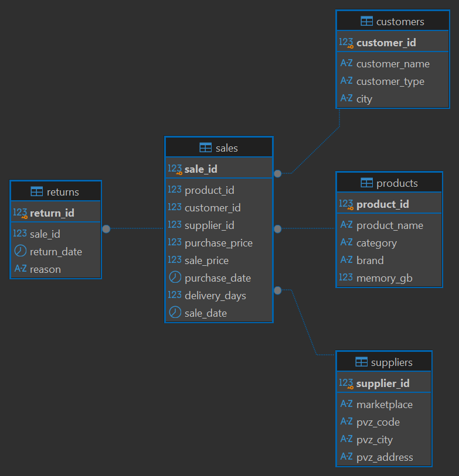

Срок оборота считается как разница между датой продажи и датой закупки. Маржа — как разница цены продажи и цены закупки.

## 4. Анализ

### 4.1 Базовые показатели

| Показатель | Значение |
|---|---|
| Продаж | 656 |
| Выручка | 36 198 542 ₽ |
| Стоимость закупки | 33 621 842 ₽ |
| Маржа | 2 576 700 ₽ |
| Средняя маржа продажи | 7,97% |
| Средний срок оборота | 14,74 дня |

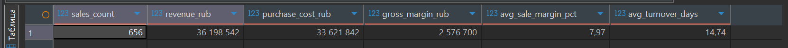

### 4.2 Категории, товары и бренды

| Категория | Продаж | Выручка, ₽ | Маржа, ₽ | Средняя маржа, % | Срок оборота, дней |
|---|---|---|---|---|---|
| Игровые приставки | 367 | 16 958 526 | 1 075 700 | 6,78 | 14,68 |
| Телефоны | 122 | 9 897 278 | 710 300 | 7,58 | 14,53 |
| Ноутбуки | 100 | 7 125 222 | 594 300 | 9,24 | 15,43 |
| Видеокарты | 18 | 1 015 701 | 68 100 | 7,71 | 15,39 |
| Наушники | 23 | 321 230 | 53 500 | 19,82 | 13,57 |
| Планшеты | 19 | 746 756 | 48 400 | 7,05 | 15,05 |
| Колонки | 7 | 133 829 | 26 400 | 23,31 | 12,71 |

Наушники и колонки показывают самую высокую процентную маржу и самый короткий оборот, но продаж в них мало (23 и 7), поэтому вывод по ним — гипотеза для проверки.

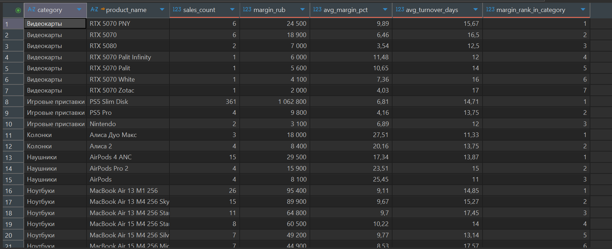

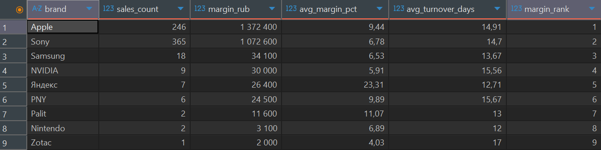

### 4.3 ABC-анализ

12 товаров относятся к классу A (80% маржи), 18 — к классу B и 18 — к классу C. PS5 Slim Disk даёт 41,25% маржи, iPhone 16 Pro Max 256 Desert — ещё 15,71%.

```sql
WITH product_margin AS (
    SELECT p.product_id, p.product_name, COUNT(*) AS sales_count,
           SUM(s.sale_price - s.purchase_price) AS margin_rub
    FROM sales s
    JOIN products p ON p.product_id = s.product_id
    GROUP BY p.product_id, p.product_name)
SELECT product_id, product_name, sales_count, margin_rub,
       ROUND(margin_rub::numeric / NULLIF(SUM(margin_rub) OVER (), 0) * 100, 2) AS margin_pct,
       ROUND(SUM(margin_rub) OVER (ORDER BY margin_rub DESC, product_name
             ROWS BETWEEN UNBOUNDED PRECEDING AND CURRENT ROW)::numeric
             / NULLIF(SUM(margin_rub) OVER (), 0) * 100, 2) AS cumulative_pct
FROM product_margin
ORDER BY margin_rub DESC, product_name
```

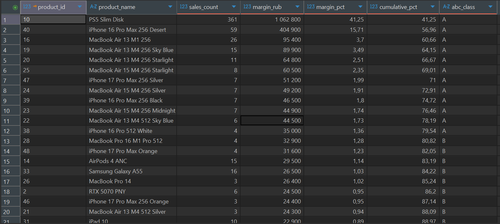

### 4.4 Динамика по месяцам

Количество продаж в месяц — от 39 до 67, маржа — от 132 400 ₽ до 329 300 ₽, средний срок оборота около 14,7 дня. Скользящая средняя маржи за три месяца считалась оконной функцией. Полных месяцев наблюдений 13, этого мало, чтобы отделить сезонность от случайных колебаний.

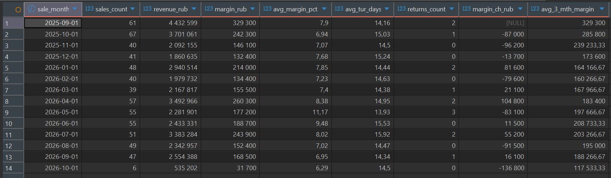

### 4.5 Б2Б и Б2С

| Канал | Продаж | Выручка, ₽ | Маржа, ₽ | Средняя маржа, % | Срок оборота, дней | Возвратов | Доля возвратов, % |
|---|---|---|---|---|---|---|---|
| Б2Б | 526 | 28 919 277 | 2 018 100 | 7,77 | 14,74 | 10 | 1,90 |
| Б2С | 130 | 7 279 265 | 558 600 | 8,78 | 14,72 | 4 | 3,08 |

Б2Б даёт 80,2% продаж и 78,3% маржи, Б2С — выше процентная маржа и выше доля возвратов; срок оборота у каналов практически одинаковый. Выборка возвратов мала (14 случаев), поэтому разницу в их доле нельзя считать устойчивой.

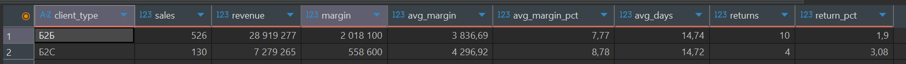

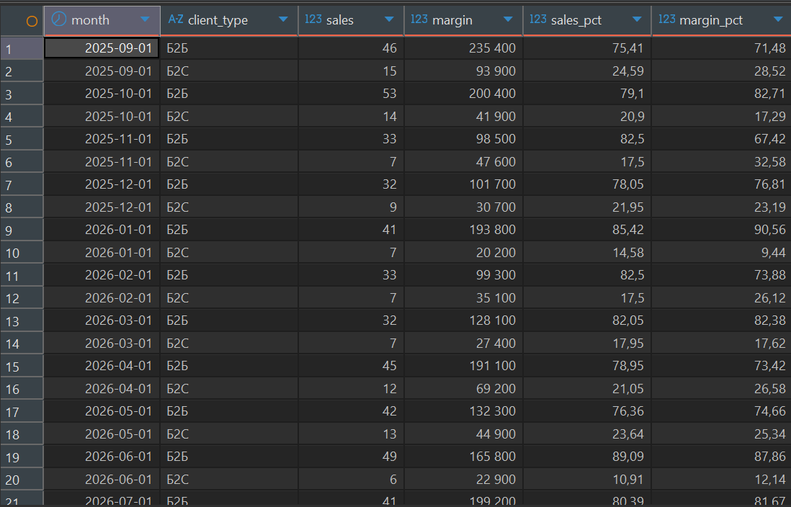

### 4.6 Маркетплейсы и города

Средний срок доставки по комбинациям маркетплейс и город — от 9,1 до 10,6 дня, средний срок оборота — от 14,4 до 15,7 дня. Самая долгая доставка у Яндекс Маркета в Москве (10,58 дня), самый долгий оборот у Wildberries в Ростове (15,66 дня). Различия между площадками небольшие.

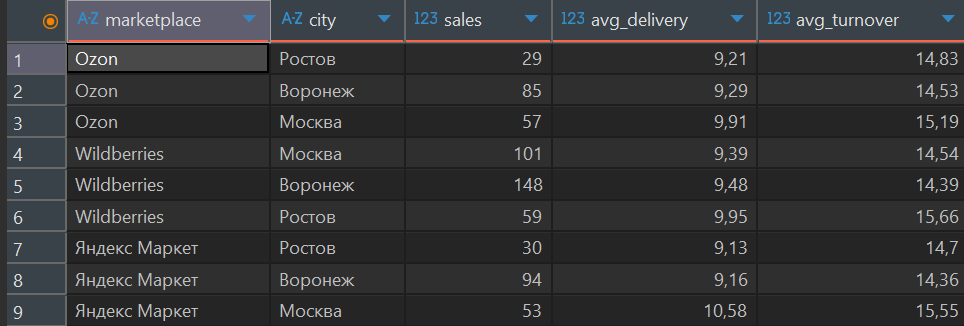

## 5. Выводы и рекомендации

**1. Высокая концентрация продаж и маржи создаёт риск зависимости от одного товара.**
PS5 Slim Disk — 361 из 656 продаж (55,03%) и 1 062 800 ₽ маржи (около 41,25%). Изменение закупочных цен или спроса по этой позиции сильно влияет на результат. Отказываться от неё нецелесообразно: это крупнейший источник маржи.
Рекомендация: контролировать долю отдельных товаров в марже и закупочном бюджете, постепенно расширять ассортимент за счёт товаров классов A и B, проверяя спрос, оборачиваемость и фактическую доходность.

**2. Максимальная абсолютная маржа не означает максимальную эффективность использования капитала.**
Приставки дают около 41,7% общей маржи при средней марже 6,78%. У ноутбуков средняя маржа с продажи 5 943 ₽ при доходности 0,684% в день, у телефонов 5 822 ₽ и 0,602% в день. Наушники и колонки показывают 1,652% и 2,134% в день, но на выборке из 23 и 7 продаж.
Рекомендация: дополнить анализ абсолютной маржи доходностью вложенного капитала с учётом срока оборота; приоритет закупок определять по доходности, объёму спроса, стабильности и риску.

**3. Динамика продаж нестабильна, данных недостаточно для подтверждения сезонности.**
Рекомендация: отслеживать месячную маржу вместе с количеством продаж, средней маржой с продажи и сроком оборота; расширить период наблюдения и сравнивать сопоставимые периоды.

## 6. Дашборд Power BI «Обзор бизнеса»

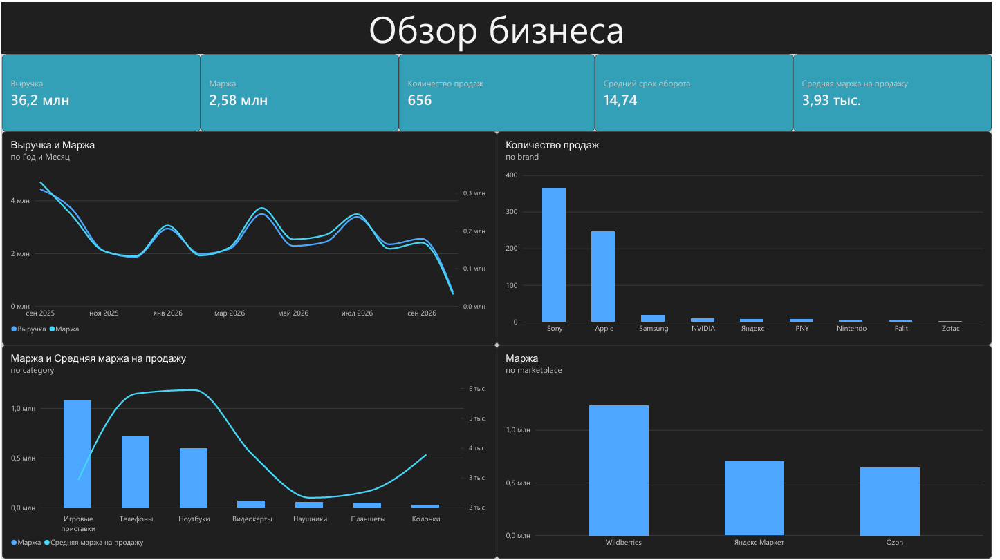

- Карточки: выручка, маржа, количество продаж, средний срок оборота, средняя маржа на продажу.
- Линейная диаграмма: выручка и маржа по датам продаж (год и месяц).
- Столбчатая диаграмма: количество продаж по брендам.
- Комбинированная диаграмма: маржа и средняя маржа на продажу по категориям.
- Столбчатая диаграмма: маржа по маркетплейсам.

## 7. Процесс закупки: AS-IS и TO-BE

Закупка выполняется вручную: покупатель ищет позиции на маркетплейсе, настраивает фильтры, проверяет карточку, считает маржу и только потом оформляет заказ. В TO-BE эти шаги берёт на себя бот.

### AS-IS: ручная закупка

Покупатель открывает маркетплейс, ищет позицию по названию, настраивает фильтры (категория, диапазон цены, рейтинг, число отзывов), открывает карточку, сверяет цену с таблицей закупочных цен, считает маржу, проверяет соответствие требованиям, добавляет товар в корзину, указывает количество, выбирает способ получения и оплаты. На оплату даётся 30 минут: если оплата не прошла, резерв заказа истекает.

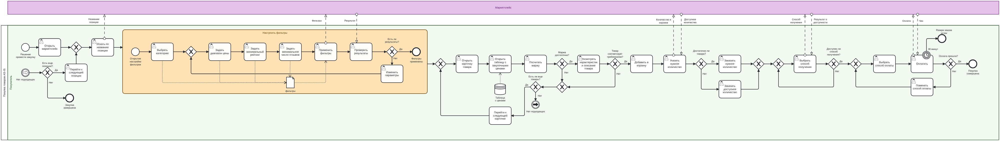

### TO-BE: бот подбирает позиции

Бот запускается каждые 15 минут и при снижении цены по отслеживаемой позиции. Он ищет позицию, применяет сохранённые фильтры, считывает цену и наличие, оценивает товар по таблице закупочных цен и считает маржу. Если товар подходит, бот отправляет покупателю сообщение со ссылкой; покупатель переходит по ссылке и оформляет заказ. Если фильтров нет, фиксируется событие «необходимо добавление фильтров».

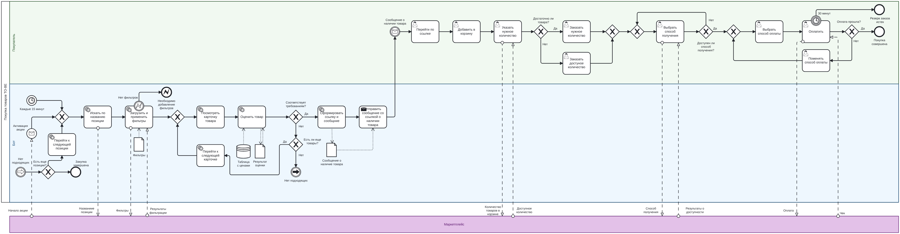

## 8. Требования к боту

### User stories

| Роль | Хочу | Критерий приёмки |
|---|---|---|
| Покупатель | получить ссылку на позицию с ценой и расчётом маржи, чтобы оценить её без самостоятельного поиска | сообщение содержит ссылку, цену, маржу и время отправки |
| Покупатель | чтобы бот не присылал дубли по позиции | повторное уведомление не приходит, пока идёт резерв 30 минут |
| Покупатель | получать уведомления только о товарах, доступных для покупки | бот проверяет цену и наличие перед отправкой уведомления |
| Владелец бизнеса | менять пороги маржи и фильтры без обращения к разработчику | изменение таблицы настроек применяется в следующем цикле |
| Владелец бизнеса | чтобы бот автоматически искал товары из списка отслеживаемых позиций | бот обрабатывает каждую позицию; если товар не найден, записывает статус и переходит к следующей |
| Владелец бизнеса | чтобы бот автоматически применял сохранённые фильтры к результатам поиска | для каждой позиции применяются сохранённые фильтры |
| Владелец бизнеса | чтобы бот рассчитывал маржу товара в рублях и процентах | для каждой подходящей позиции рассчитывается маржа в рублях и процентах |
| Владелец бизнеса | чтобы бот запускал мониторинг каждые 15 минут | цикл запускается каждые 15 минут с отклонением не более одной минуты |
| Владелец бизнеса | чтобы бот запускал внеплановый поиск при снижении цены | при событии о снижении цены запускается обработка соответствующей позиции |

### Функциональные требования

Приоритет по MoSCoW: M — обязательно, S — желательно, C — по возможности.

| ID | Требование | Приоритет | Критерий приёмки |
|---|---|---|---|
| ФТ-1 | Бот запускается по таймеру каждые 15 минут | M | Цикл стартует в пределах ±1 минуты от расписания, запуск виден в журнале |
| ФТ-2 | При снижении цены отслеживаемого товара бот инициирует внеплановую обработку позиции | M | Событие запускает обработку вне расписания; повторное событие по той же позиции в течение 15 минут не вызывает повторный запуск |
| ФТ-3 | Бот ищет позицию по названию из списка отслеживаемых | M | Для каждого названия в журнале есть результат поиска |
| ФТ-4 | Бот загружает и применяет сохранённые фильтры | M | Фильтры применены, число результатов после фильтрации записано в журнал |
| ФТ-5 | Если набор фильтров для позиции пуст, бот завершает обработку позиции и фиксирует событие «необходимо добавление фильтров» | S | Событие попадает в журнал, остальные позиции обрабатываются |
| ФТ-6 | Бот открывает карточку товара и считывает цену и наличие | M | Цена и наличие записаны в журнал вместе со временем считывания |
| ФТ-7 | Бот оценивает товар по таблице закупочных цен и считает маржу | M | Результат («подходит» или «не подходит») сохранён вместе с маржой и порогом, по которому принято решение |
| ФТ-8 | Бот последовательно обрабатывает позиции и завершает цикл после обработки всех доступных позиций либо по лимиту | M | Фиксируется статус завершения и число обработанных, пропущенных и ошибочных позиций; цикл не остаётся выполняющимся бесконечно |
| ФТ-9 | Бот отправляет покупателю сообщение со ссылкой, ценой и расчётом маржи | M | Сообщение приходит с рабочей ссылкой, содержит цену и маржу |
| ФТ-10 | Бот сохраняет время отправки каждого сообщения | M | Для каждого уведомления есть метка времени для расчёта задержки до оплаты |
| ФТ-11 | Порог отбора задаётся отдельно для категории или позиции (минимальная маржа в ₽ и в %) | M | Изменение порога влияет на отбор в следующем цикле |
| ФТ-12 | Бот не отправляет повторное уведомление по позиции, пока идёт резерв (30 минут) | S | В течение окна резерва дубль не создаётся |
| ФТ-13 | Покупатель может пометить исход уведомления (куплено, отказ, не успел) | C | Исход сохраняется и используется для расчёта доли уведомлений, закончившихся покупкой |
| ФТ-14 | Бот предотвращает одновременную обработку одной позиции несколькими циклами | M | Для одной позиции не выполняются параллельные дублирующие циклы |
| ФТ-15 | Пользователь может изменять список отслеживаемых товаров | C | Изменённый список используется в следующем цикле |

### Нефункциональные требования

| ID | Категория | Требование | Метод проверки |
|---|---|---|---|
| НФТ-1 | Производительность | Задержка от события «снижение цены» до отправки уведомления не более 2 минут | Сравнение времени события и метки времени сообщения по журналу |
| НФТ-2 | Производительность | Полный цикл по списку из 1000 позиций укладывается в 10 минут | Замер длительности цикла по журналу |
| НФТ-3 | Доступность | Круглосуточная работа, допустимый простой не более 12 часов в месяц | Журнал запусков, подсчёт пропущенных циклов |
| НФТ-4 | Надёжность | При ошибке маркетплейса (недоступен, изменилась вёрстка, капча) — 3 повторные попытки, затем пропуск позиции и сообщение об ошибке покупателю | Тест с имитацией сбоя |
| НФТ-5 | Надёжность | Сбой по одной позиции не останавливает обработку остальных | Тест с одной заведомо неработающей позицией |
| НФТ-6 | Точность | Расхождение между маржой бота и маржой, посчитанной вручную по той же карточке, не более 1% | Выборочная проверка 30 уведомлений |
| НФТ-7 | Актуальность данных | Таблица закупочных цен обновляется не реже 1 раза в неделю | Дата обновления в таблице |
| НФТ-8 | Безопасность | Доступ к таблице цен и настройкам бота только у владельца; токены и пароли не хранятся в открытом виде | Проверка прав доступа и конфигурации |
| НФТ-9 | Сопровождаемость | Фильтры и пороги меняются без правки кода, через таблицу настроек | Изменение порога и проверка результата в следующем цикле |
| НФТ-10 | Соблюдение правил площадок | Частота запросов к маркетплейсам не превышает ограничений площадки | Анализ условий использования |

## 9. Что сделано в проекте

- Спроектирована база из пяти таблиц с ограничениями целостности и загружены данные.
- Написаны SQL-запросы по шести аналитическим вопросам (агрегаты, JOIN, CTE, оконные функции).
- Собран дашборд Power BI «Обзор бизнеса».
- Описан процесс закупки в BPMN 2.0: AS-IS и TO-BE.
- Сформулированы user stories, функциональные и нефункциональные требования к боту с критериями приёмки и приоритетами MoSCoW.
