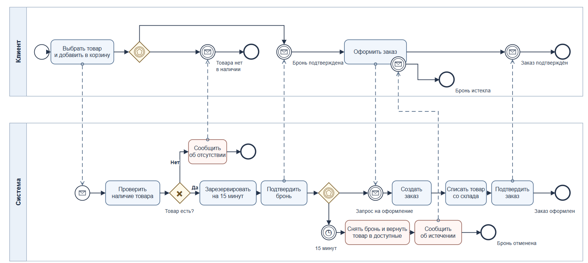
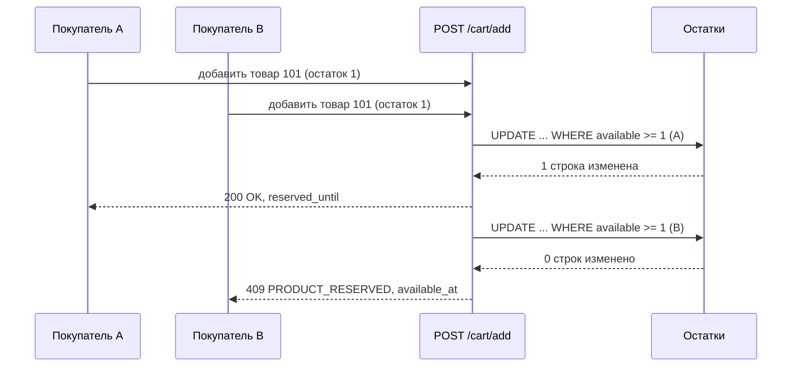

# 2. BPMN: добавление в корзину, бронь 15 минут, оформление и оплата

## 2.1 Диаграмма BPMN

Покрывает требования задания: проверка наличия, бронь на 15 минут, оформление заказа в срок, снятие брони по таймеру.

## 2.2 Диаграмма последовательности: гонка за последнюю единицу

