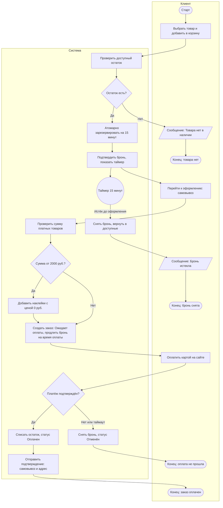
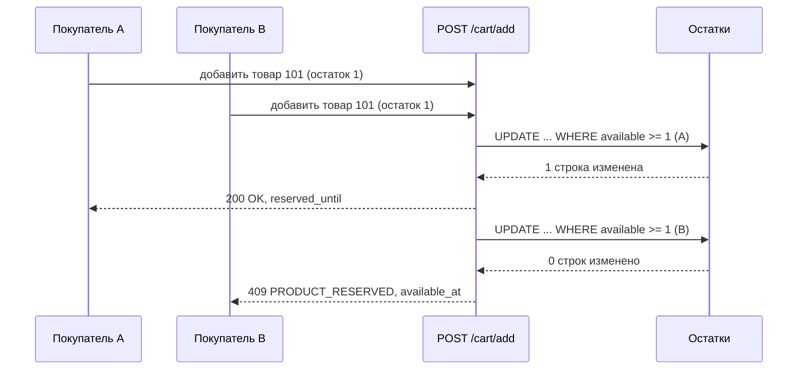

# 2. BPMN: добавление в корзину, бронь 15 минут, оформление и оплата

## 2.1 Исходная диаграмма (из задания)

Покрывает требования задания: проверка наличия, бронь на 15 минут, оформление заказа в срок, снятие брони по таймеру.

## 2.2 Замечания к исходной диаграмме

1. Заказ создаётся и товар списывается сразу после запроса на оформление. При оплате картой это неверно: оплата может не пройти. Правильно: создать заказ в статусе «Ожидает оплаты», держать бронь, списать остаток после подтверждения оплаты.
2. Нет ветки «оплата не прошла» и таймаута оплаты.
3. Нет шага выдачи подарка (наклейки при сумме от 2 000 ₽) и выбора самовывоза.
4. Событие «Бронь истекла» на стороне клиента должно прерывать оформление, а не только уведомлять.

## 2.3 Улучшенный процесс (To-Be)

Файл с диаграммой: [order-flow.mmd](order-flow.mmd) (формат Mermaid, GitHub отображает его автоматически). Готовое изображение: [bpmn-to-be.png](../assets/bpmn-to-be.png).

## 2.4 Правила процесса

| Правило | Описание |
|---------|----------|
| BR-1 | Бронь создаётся атомарно: доступно = остаток − активные брони |
| BR-2 | Срок брони 15 минут с момента добавления в корзину, таймер на позицию |
| BR-3 | При переходе к оплате бронь продлевается на время платежа (по умолчанию 10 минут, подтвердить у заказчика) |
| BR-4 | Остаток списывается только после подтверждения оплаты |
| BR-5 | Подарок: сумма платных товаров `>= 2000` ₽, наклейки по цене 0 ₽, при наличии на складе |
| BR-6 | Единственный способ получения: самовывоз из магазина |
| BR-7 | Единственный способ оплаты: банковская карта онлайн |

## 2.5 Диаграмма последовательности: гонка за последнюю единицу

