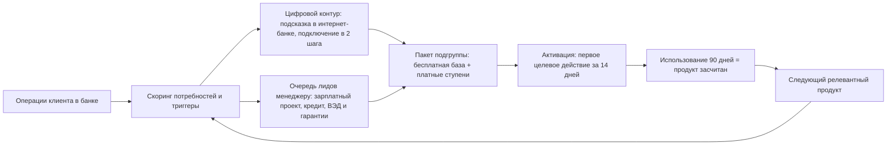
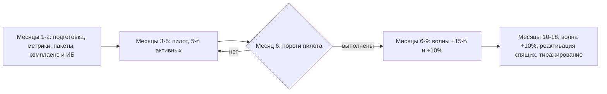

# Рост продуктового проникновения среди клиентов СМБ ВТБ

Решение кейса ВТБ Cup Moscow 2026, 1 тур. Исходное задание: [`docs/source/case.pdf`](docs/source/case.pdf).
Дедлайн загрузки: **16.11.2026, 12:00 (Москва)**. Статус: аналитика и расчеты готовы, презентация не собрана. Что осталось: [`OPEN_QUESTIONS.md`](OPEN_QUESTIONS.md).

## Решение за минуту

Сегмент **«торговля»** (28,9% базы Москвы и МО) делится на три подгруппы по задачам клиента. Каждой подгруппе собирается свой пакет: бесплатная база небанковских сервисов (бухгалтерия, ЭДО) как вход, платные ступени как источник дохода. Подключение идет в два шага из интернет-банка, предложения запускаются по событиям в операциях клиента, менеджер занимается только сложными продуктами. Рост считается по продуктам, которые клиент **реально использует** (активность за 90 дней), а не по подключенным.

| Показатель | Значение |
|---|---|
| Клиентов в сегменте / активных | 86 700 / 69 360 |
| Стартовое среднее число продуктов | 1,96 |
| Цель: действующие / новые | 5 / 4 продукта |
| Охват в основном сценарии | 40% активных, 27 744 клиента |
| Среднее у охваченных к 18-му месяцу | 5,00 |
| Среднее по всей торговле к 18-му месяцу | 3,18 |
| Среднее по базе Москвы и МО: было → стало | 1,96 → 2,24 (84 342 дополнительных используемых продукта) |
| Максимум без небанковских сервисов | 3,40 |
| Нагрузка на менеджера | 5,1% рабочего времени, штат не растет |
| Эффект, ядро без эквайринга | около 230 млн ₽ в год (действующие 207,5, из них небанковские 158,8) |
| Эффект с эквайрингом | 410-662 млн ₽ в год (эквайринг действующих 145,7-349,6) |

**Чего решение не обещает.** Цель 5 достигается у охваченных клиентов, но не в среднем по всей торговле: 3,18 к месяцу 18. Это показано честно, остальное закрывается тиражированием на другие отрасли (следующий этап). Цены, доли платящих, оборот эквайринга и доля привлечения новых клиентов являются допущениями команды, а не данными кейса.

## Решение подробно

### 1. Анализ продуктов и барьеров → [`docs/02`](docs/02-products-barriers-competitors.md)

У ВТБ более 10 банковских продуктов и более 20 небанковских сервисов, но проникновение 1,7-2,2 не растет три года, а небанковскими сервисами пользуется около 1% клиентов. Банковские продукты дают максимум 3,40 на клиента, поэтому без небанковских сервисов цель не закрывается. Барьеры (не знают о предложении, привязаны к стороннему поставщику, подключение сложное, 300 клиентов на менеджера, подключение не равно использованию) в кейсе не подтверждены данными, поэтому поданы как гипотезы с указанием, чем их проверить. У Сбера, Т-Банка, Альфа-Банка и Точки общая модель: бесплатная базовая бухгалтерия в тарифе, платный апгрейд сверху.

### 2. Выбор сегмента → [`docs/03`](docs/03-segment-jtbd-cjm.md)

Торговля выбрана за размер (около 86,7 тыс. клиентов, 69,4 тыс. активных), широкий набор релевантных продуктов (8-10, запас до цели 5) и JTBD, который кейс приводит сам (кассовый разрыв между закупкой и выручкой). Сравнивались строительство и консалтинг. Подгруппы (деление 45/25/30% является допущением):

| Подгруппа | Главная задача | Ключевые продукты |
|---|---|---|
| Офлайн-розница | Принимать оплату и не уходить в кассовый разрыв | эквайринг, бизнес-карта, зарплатный проект, бухгалтерия |
| Опт и B2B | Работать с контрагентами без бумаги, закупать до прихода денег | ЭДО, кредит, гарантии, ВЭД |
| Маркетплейсы | Видеть реальный результат, не утонуть в учете | бухгалтерия с маркетплейсами, кредитная карта, продвижение |

### 3. Целевая модель взаимодействия → [`docs/03`](docs/03-segment-jtbd-cjm.md), [`docs/04`](docs/04-trajectory-implementation.md)



Цифровой контур дает около 84% прироста (2,56 продукта на клиента), менеджер около 16% (0,48). Менеджеру платят за продукты, которыми клиент пользуется через 90 дней, а не за подключение. Данные клиентов используются только внутри банка, партнерам передаются только по согласию, ИИ-подсказки работают на обезличенных данных.

### 4. CJM → [`docs/03`](docs/03-segment-jtbd-cjm.md)

Персона: владелец магазина, ООО на УСН, 5-8 сотрудников, 2 продукта ВТБ. Шесть этапов: потребность → знакомство → подключение → первое использование → регулярное использование → следующий продукт. Самые рискованные точки: активация (подключил, но не перенес процессы) и удержание (вернулся к стороннему поставщику). Для новых клиентов первые два этапа заменяет онбординг-пакет при открытии счета.

### 5. План внедрения и траектория → [`docs/04`](docs/04-trajectory-implementation.md)



Пороги пилота: среднее у когорты не ниже 3,0 (модель дает 3,48), активация не ниже 60%, нагрузка менеджеров в расчетных пределах. Подробные таблицы по месяцам, ответственные подразделения, KPI и пороги «используемого» продукта по каждому продукту в `docs/04`. Консервативный сценарий (когорта выходит на цель за 9 месяцев) сдвигает достижение цели на 21-й месяц.

### 6. Экономика → [`docs/05`](docs/05-economics-risks.md)

По правилам Приложения 3 кейса: клиенты, реально использующие продукт, умножаются на прямой платеж за год; считается только прирост; кредиты, депозиты, ВЭД и гарантии не учитываются (процентный доход). Бесплатная база дохода не дает, деньги приходят с платных ступеней. Небанковская выручка составляет 14-16% от расходов клиентов на услуги (35-40 тыс. ₽ в год). Эквайринг вынесен в отдельный блок с вилкой, потому что опирается на оценку оборота и комиссии. Чувствительность, новые клиенты и масштаб на Россию (около 2,1-3,3 млрд ₽ с эквайрингом) в `docs/05`.

### 7. Риски → [`docs/05`](docs/05-economics-risks.md)

Карта из 11 рисков с вероятностью, влиянием, мерами и сигналом раннего предупреждения. Главные: формальное подключение без использования, низкий отклик на небанковские сервисы, оборот эквайринга ниже допущения, срок подготовки IT.

## Где что искать по заданию кейса

| Требование кейса | Где |
|---|---|
| Задание 1: анализ продуктов, возможности и барьеры | [`docs/02`](docs/02-products-barriers-competitors.md) |
| Обзор существующих практик | [`docs/02`](docs/02-products-barriers-competitors.md), раздел «Практики конкурентов» |
| Задание 2: сегмент, масштаб, вклад в цель ВТБ | [`docs/03`](docs/03-segment-jtbd-cjm.md), [`docs/04`](docs/04-trajectory-implementation.md) |
| Схема целевой модели, CJM | этот файл, [`docs/03`](docs/03-segment-jtbd-cjm.md) |
| Задания 3 и 4: сроки, этапы, ресурсы, подразделения, KPI | [`docs/04`](docs/04-trajectory-implementation.md) |
| Задание 5: экономический эффект | [`docs/05`](docs/05-economics-risks.md), [`calc/RESULTS.generated.md`](calc/RESULTS.generated.md) |
| Задание 6: риски и меры | [`docs/05`](docs/05-economics-risks.md) |
| Ограничения кейса, исходные данные, критерии | [`docs/00`](docs/00-case-summary.md) |
| Принятые решения и реестр допущений | [`docs/01`](docs/01-decisions-and-assumptions.md) |

## Карта репозитория

```
README.md                    этот файл
OPEN_QUESTIONS.md            открытые вопросы, что не сделано, план до дедлайна
docs/
  00-case-summary.md         задание, ограничения, данные, критерии
  01-decisions-and-assumptions.md   решения и реестр допущений
  02-products-barriers-competitors.md   продукты, барьеры, конкуренты, источники
  03-segment-jtbd-cjm.md     сегмент, JTBD, CJM
  04-trajectory-implementation.md   этапы, траектория, менеджеры, KPI, данные и ИБ
  05-economics-risks.md      экономика, чувствительность, риски
  source/case.pdf            исходное задание
calc/
  assumptions.json           все входные данные и допущения модели
  model.py                   расчетная модель
  RESULTS.generated.md       вывод модели (не править вручную)
  key_figures.json           ключевые цифры для проверки документов
  check_docs.py              сверка цифр в документах с моделью
```

## Как работать с расчетами

```bash
python3 calc/model.py        # пересчитать: читает assumptions.json, пишет RESULTS.generated.md
python3 calc/check_docs.py   # проверить, что цифры в README и docs/ совпадают с моделью
```

Сторонние библиотеки не нужны. Чтобы изменить допущение: поправить `calc/assumptions.json`, запустить оба скрипта, обновить расхождения в документах. При расхождении цифр в тексте и в `RESULTS.generated.md` верить второму.
