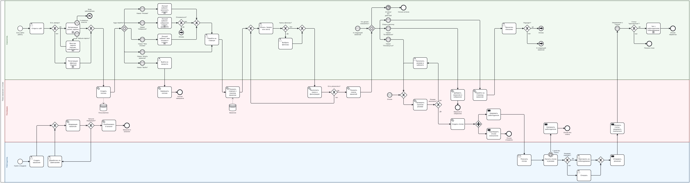
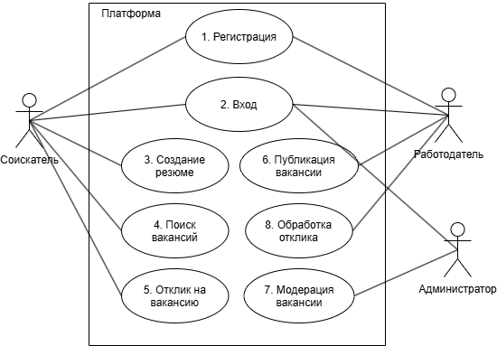
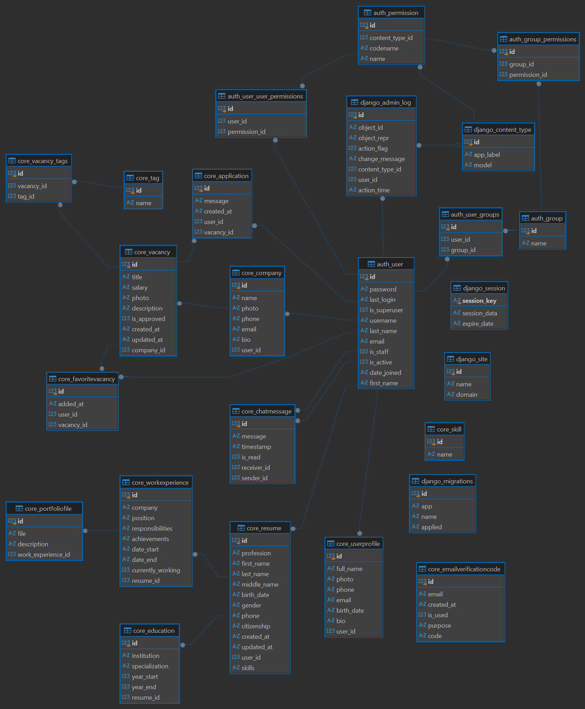

# WorkWave: платформа поиска работы

Аналитическая документация веб-платформы поиска работы по модели hh.ru: соискатели ведут резюме и откликаются на вакансии, работодатели публикуют вакансии и обрабатывают отклики, администратор модерирует публикации.

Репозиторий содержит артефакты бизнес-анализа: от пользовательских историй до требований, сценариев, BPMN-процесса и схемы данных.

## Контекст

**Цель.** Единое место, где соискатель находит удалённую работу и откликается на вакансии за несколько шагов, а работодатель публикует вакансии и обрабатывает отклики. Сервис выполнен при поддержке Фонда содействия инновациям в рамках федерального проекта «Платформа университетского технологического предпринимательства» и ВГТУ.

**Аудитория.** Соискатели и работодатели из России (учитывается ФЗ-152 о персональных данных).

**Границы.** В проект входят регистрация и вход, резюме, поиск и фильтры, избранное, отклики, личный кабинет, кабинет работодателя, модерация вакансий. Вне границ: оплата и платные размещения, мобильные приложения. Технологический стек на этапе документации не определён.

**Роль автора.** CEO проекта: полностью руководил проектом и принимал все решения.

**Статус.** Проект закрыт. Репозиторий хранит аналитическую документацию, макеты и модель данных.

## Роли

| Роль | Задачи |
|---|---|
| Соискатель | Регистрация, резюме, поиск и фильтры, избранное, отклики, личный кабинет |
| Работодатель | Профиль компании, публикация вакансий, обработка откликов, чат с кандидатом |
| Администратор | Модерация вакансий, жалобы, блокировки, справочники |
| Система | Проверки, уведомления, статусы, таймеры |

## Состав документации

| Артефакт | Что внутри | Файл |
|---|---|---|
| Пользовательские истории | 68 историй в 9 эпиках с критериями приёмки и приоритетами MoSCoW | [docs/user-stories.md](docs/user-stories.md) |
| Требования | 9 групп функциональных требований (ФТ) и 21 нефункциональное (НФТ), с источниками | [docs/requirements.md](docs/requirements.md) |
| Матрица трассировки | Эпик, требования, сценарии, элементы BPMN, пробелы покрытия | [docs/traceability.md](docs/traceability.md) |
| Сценарии использования | 8 use case с диаграммой, предусловиями, основным и альтернативными потоками | [docs/use-cases.md](docs/use-cases.md) |
| Процесс BPMN | «Поиск вакансии и отклик»: дорожки соискателя, платформы, работодателя; текстовое описание | [docs/bpmn-process.md](docs/bpmn-process.md) |
| Диаграммы состояний | Жизненные циклы отклика и вакансии | [docs/state-diagrams.md](docs/state-diagrams.md) |
| Роли и права | Матрица доступа по ролям | [docs/roles-permissions.md](docs/roles-permissions.md) |
| Схема БД | ER-диаграмма, таблицы, известные ошибки модели | [docs/database.md](docs/database.md) |
| Глоссарий | Термины проекта | [docs/glossary.md](docs/glossary.md) |
| Открытые вопросы | Принятые решения и нерешённые вопросы | [docs/open-questions.md](docs/open-questions.md) |
| Прототип | 6 экранов интерфейса, расхождения с документами | [docs/prototype.md](docs/prototype.md), [Figma](https://www.figma.com/design/IdnyTGSgoSKX4rHOgvB7s2/Untitled?node-id=0-1&t=0pEziW4ID0ZqOWna-1) |

Исходные документы Word лежат в [docs/source](docs/source): это первая версия, актуальны файлы Markdown.

## Диаграммы

### Процесс BPMN

[](docs/bpmn-process.md)

Схема крупная, по частям и с описанием: [docs/bpmn-process.md](docs/bpmn-process.md).

### Диаграмма вариантов использования



### Схема базы данных



## Как связаны артефакты

Пользовательские истории (AUTH, RES, SRCH, VAC, APP, CAB, EMP, CND, ADM) → функциональные требования (ФТ-1 … ФТ-9, в каждом указан источник) → сценарии использования (UC-01 … UC-08) → BPMN-процесс отклика → модель данных. Подробно: [матрица трассировки](docs/traceability.md).

## Структура репозитория

```
WorkWave/
├── README.md
├── docs/
│   ├── user-stories.md, requirements.md, traceability.md
│   ├── use-cases.md, bpmn-process.md, state-diagrams.md
│   ├── roles-permissions.md, database.md
│   ├── prototype.md, glossary.md, open-questions.md
│   └── source/            # исходные .docx
├── design/                # скриншоты макетов
└── diagrams/
    ├── workwave-bpmn.bpmn / .svg / .png (+ part1-3.png)
    ├── use-case-diagram.png
    └── db-schema.png
```

## Инструменты

BPMN: bpmn.io · Прототип: Figma · Документы и диаграммы состояний: Word, Markdown, Mermaid · БД: Django ORM.
