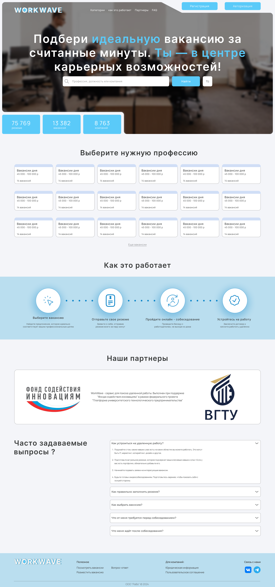
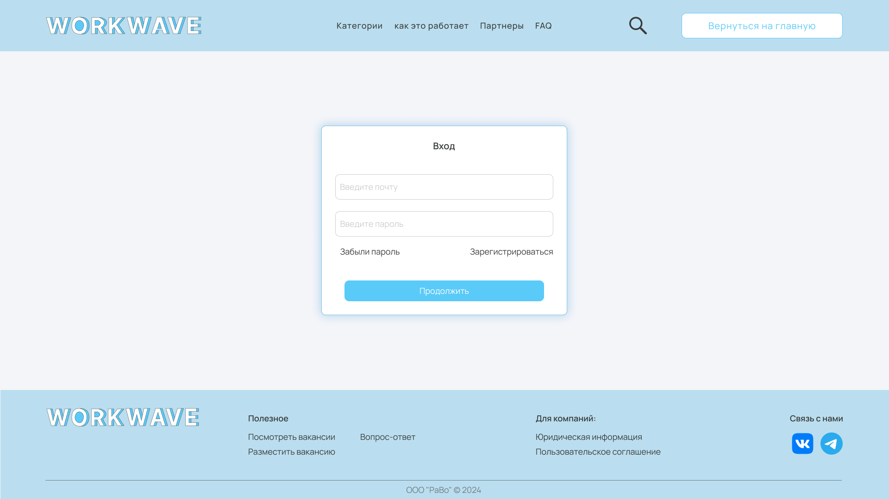
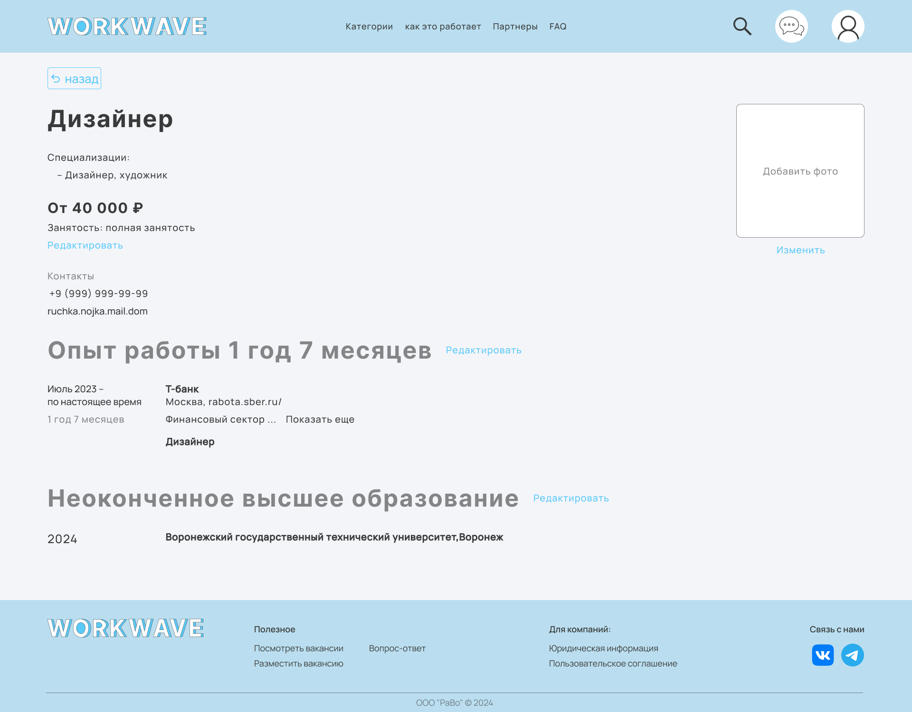
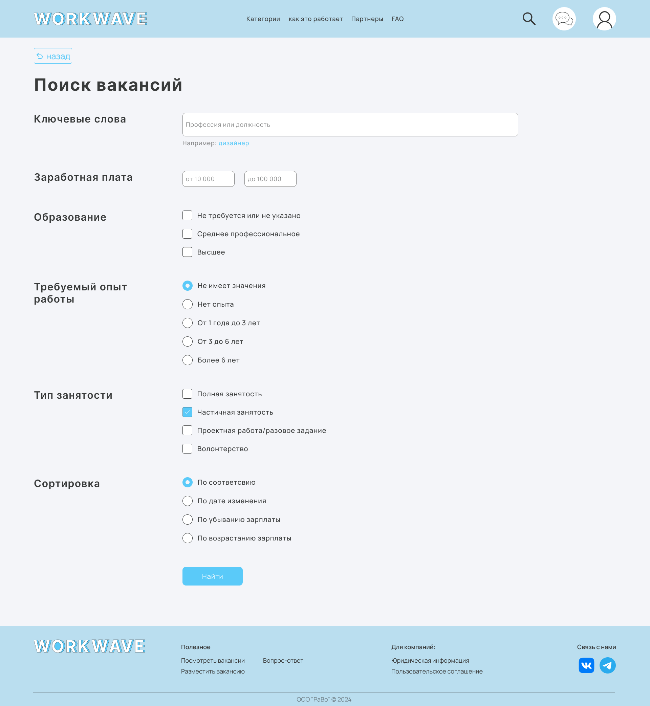
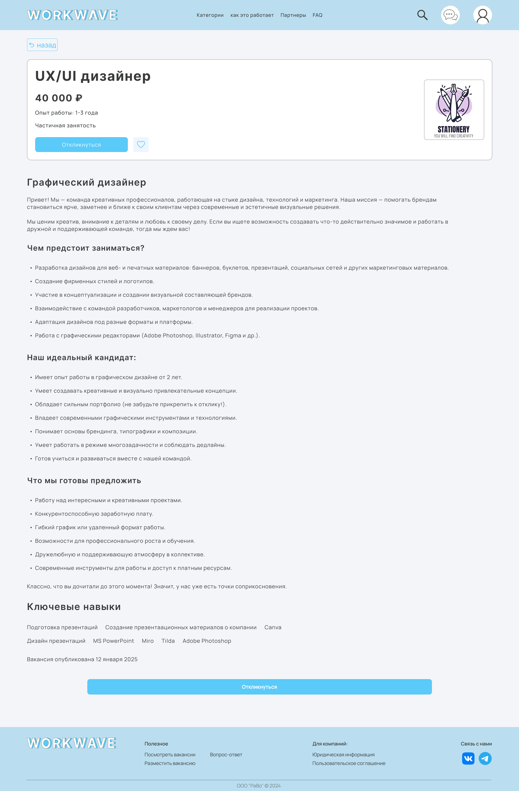
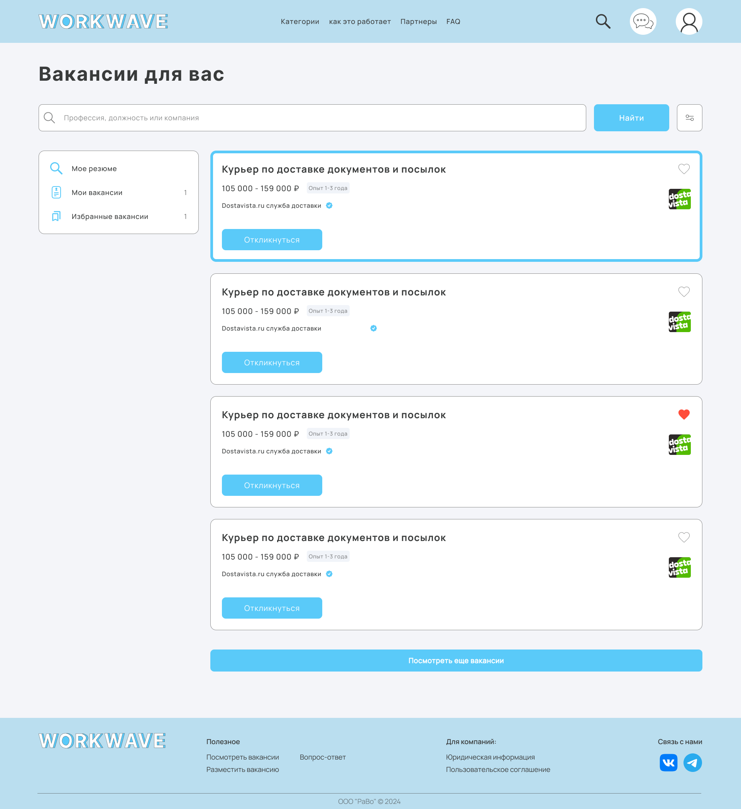

# Прототип интерфейса

Макеты экранов из Figma: [файл в Figma](https://www.figma.com/design/IdnyTGSgoSKX4rHOgvB7s2/Untitled?node-id=0-1&t=0pEziW4ID0ZqOWna-1).

| Экран | Что показано | Связанные требования и сценарии |
|---|---|---|
| [Главная для гостя](../design/01-landing.png) | Поиск, счётчики (резюме, вакансии, компании), категории профессий, блок «Как это работает», партнёры, FAQ, кнопки «Регистрация» и «Авторизация» | ФТ-1.1, ФТ-1.6, UC-01, UC-02 |
| [Вход](../design/02-login.png) | Почта, пароль, «Забыли пароль», «Зарегистрироваться» | ФТ-1.6, ФТ-1.9, AUTH-4, AUTH-5, UC-02 |
| [Резюме](../design/03-resume.png) | Специализация, желаемая зарплата, занятость, контакты, фото, опыт работы, образование, кнопки «Редактировать» | ФТ-2.1, ФТ-2.4, ФТ-2.5, ФТ-2.6, UC-03 |
| [Поиск вакансий](../design/04-search-filters.png) | Ключевые слова, зарплата, образование, опыт, тип занятости, сортировка | ФТ-3.3, ФТ-3.5, ФТ-3.8, UC-04 |
| [Карточка вакансии](../design/05-vacancy-card.png) | Название, зарплата, опыт, занятость, «Откликнуться», избранное, описание, ключевые навыки, дата публикации | ФТ-4.1, ФТ-4.3, ФТ-5.1, APP-2, UC-04, UC-05 |
| [Список вакансий](../design/06-vacancy-list.png) | Поиск, меню (резюме, мои вакансии, избранные), карточки с «Откликнуться» и сердечком, «Посмотреть ещё вакансии» | ФТ-3.1, ФТ-3.2, ФТ-4.4, SRCH-1, APP-1 |

## Главная для гостя

## Вход

## Резюме

## Поиск вакансий

## Карточка вакансии

## Список вакансий

## Расхождения макетов с документами

| № | Макет | Документы |
|---|---|---|
| 1 | Фильтры: образование, опыт, тип занятости (с волонтёрством), зарплата. Региона и графика работы нет | ФТ-3.5: регион, доход, опыт, тип занятости, график. Образования в требованиях нет |
| 2 | Сортировка: по соответствию, по дате изменения, зарплата по убыванию и возрастанию | ФТ-3.8: релевантность, дата публикации, зарплата |
| 3 | Постраничная подгрузка кнопкой «Посмотреть ещё вакансии»; счётчика найденных вакансий нет | ФТ-3.2: общее число найденных вакансий |
| 4 | Сервис позиционируется как поиск удалённой работы | В требованиях формат работы (удалённый) не выделен |
| 5 | Бейдж подтверждённой компании у работодателя | Верификация компаний в требованиях не описана |
| 6 | В резюме нет навыков и блока «О себе». Зарплатные ожидания показаны | ФТ-2.1: навыки и «О себе» обязательные разделы |
| 7 | В меню списка вакансий «Мои вакансии» с числом | Не определено, это отклики или вакансии работодателя |
| 8 | Опечатки: «выпросы» (FAQ), «презентаационных» (карточка вакансии) | Исправить в макете |
