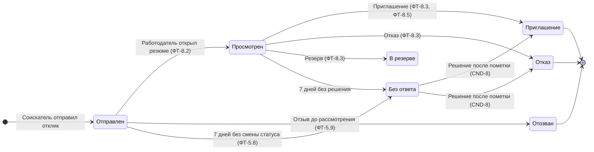
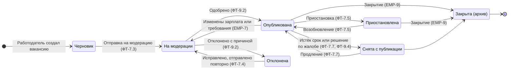

# Диаграммы состояний

Наборы статусов собраны из пользовательских историй (CAB-1, CND-4, EMP-5, EMP-9), требований и BPMN. Единого описания переходов в исходных документах нет, поэтому диаграммы составлены по совокупности требований и помечены как производные.

## Отклик

Правила:
- Возврат к предыдущему статусу запрещён (CND-4).
- Каждая смена статуса записывается в историю с датой (ФТ-5.7, НФТ-20) и уведомляет соискателя.
- Чат открывается после статуса «Приглашение» (CAB-3, CND-7).
- Переходы из «В резерве» в исходных документах не описаны, см. [open-questions.md](open-questions.md).

## Вакансия

Правила:
- Модерация выполняется в течение 24 часов (EMP-5, ADM-1).
- Мелкие правки опубликованной вакансии не требуют повторной модерации (EMP-7).
- Отклики остаются доступны после закрытия вакансии; в избранном она помечается закрытой (EMP-9, VAC-7).
- Отклик на снятую или закрытую вакансию не принимается (ФТ-5.5).
